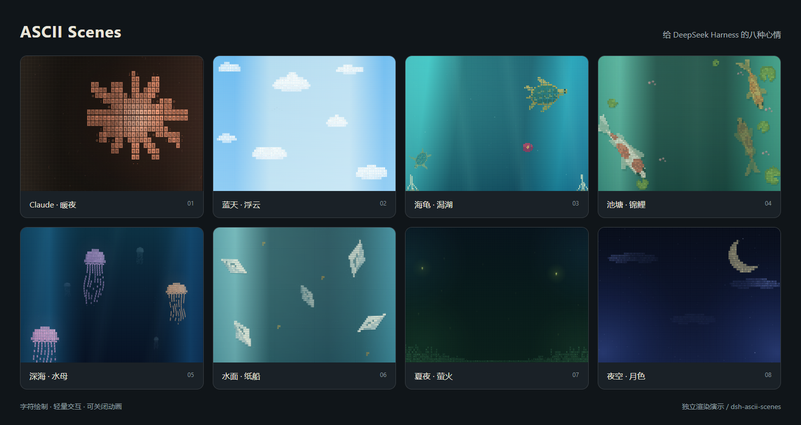
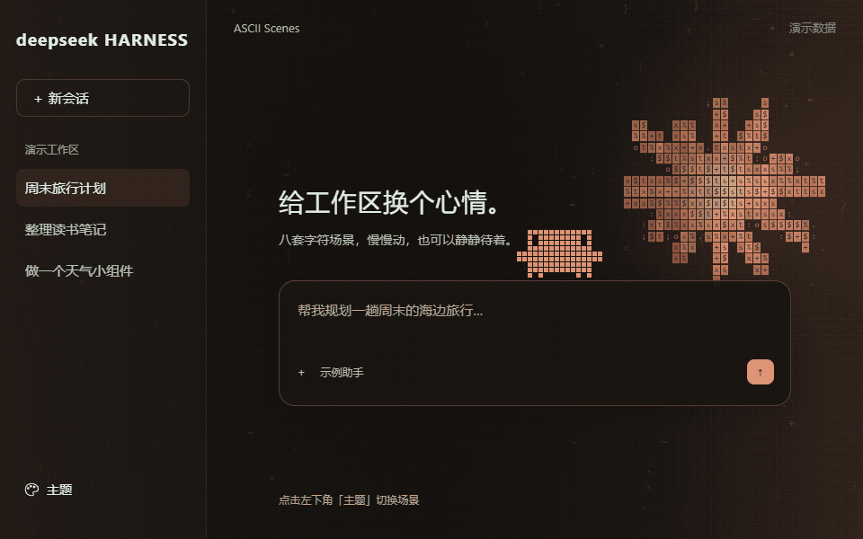

# ASCII Scenes

给 **DeepSeek Harness（dsh）** 换上会动的字符场景。八套主题、一键切换，阅读时背景自动收敛，也可以关闭动画。





图片和 GIF 来自独立演示页，使用插件真实渲染代码与虚构工作区内容，不包含真实聊天、账号或项目数据。演示页模拟宿主布局，不是 dsh 实机录像。

## 有哪些场景

| 场景 | 效果与交互 |
| --- | --- |
| Claude · 暖夜 | 暖色字符太阳、漂浮微粒、小蟹偶尔散步，点击回应 |
| 蓝天 · 浮云 | 浮云与鸟群缓慢移动，点击吹起一阵风 |
| 海龟 · 潟湖 | 海龟划水、珊瑚与漂浮花朵，点击附近海龟产生游动回应 |
| 池塘 · 锦鲤 | 锦鲤、荷叶与落花，点击水面产生渐隐水波 |
| 深海 · 水母 | 水母收缩游动，点击水母或水面产生回应 |
| 水面 · 纸船 | 纸船随水漂动，点击水面扰动水流 |
| 夏夜 · 萤火 | 草丛与萤火，点击附近光点轻轻散开 |
| 夜空 · 月色 | 月牙、流云与星空，点击唤起零星闪光 |

背景覆盖侧栏与主工作区；正文、输入框和主题面板使用对应配色。背景点击会避开按钮、输入框、文本、拖动和文字选择。支持系统「减少动态效果」，页面隐藏时暂停动画。

## 安装

面向 dsh 桌面/Web 界面，插件 **0.5.0** 已在 **dsh 0.2.1-rc.3、0.2.1-rc.5** 中验证。rc.5 的八套主题切换、动画开关、刷新后保留设置、原生外观恢复、禁用/重新启用及输入焦点检查均通过，无需修改插件或升级插件版本。

rc.5 的完整交互检查在独立空白 Web profile 中完成，桌面版另确认主题入口和小蟹加载，具体范围见[验证记录](docs/verification.md)。包声明的兼容范围仍为 `>=0.2.1-rc.3 <0.3.0-0`；该范围不表示每个宿主版本都已逐版验证。

桌面版，在终端执行：

```sh
dsh plugin --profile desktop add github:Srelka/dsh-ascii-scenes#v0.5.0
```

使用 `dsh web` 时：

```sh
dsh plugin --profile web add github:Srelka/dsh-ascii-scenes#v0.5.0
```

安装后重启对应的 dsh 桌面应用或 Web 服务。仓库附带已构建的 `client.js`，安装时无需构建。

打开左侧栏底部 **主题**，或 **设置 → 通用 → 场景主题**，选择一个场景。关闭「场景动画」可保留静态背景；切回「原生外观」或禁用插件会恢复进入场景前的浅色、深色或跟随系统设置。

卸载时选择对应 profile：

```sh
dsh plugin --profile desktop remove dsh-ascii-scenes
```

重启后生效。其他修改背景或主题配色的插件可能覆盖相同样式，建议一次启用一套外观方案。

## 插件市场

这是可直接从 Git 安装的 Profile Bundle，包含公开包元数据、中英文简介、图标、预构建入口与版本标签；GitHub topic 使用 `dsh-plugin`。

[dsh 官方索引生成器](https://github.com/deepseek-ai/deepseek-harness/blob/master/apps/plugin-market-generator/README.md)支持将本仓库 URL 加入源列表：

```text
https://github.com/Srelka/dsh-ascii-scenes
```

也可在 dsh 的「自定义插件市场」中添加本插件的索引源：

```text
https://raw.githubusercontent.com/Srelka/dsh-ascii-scenes/main/market/index.json
```

第三方市场是否收录、何时刷新，由各市场维护者决定；提供安装包和索引不代表已获第三方市场审核。

## 数据与权限

- 插件只提供界面与动画，不注册模型工具或提示词，不读取会话文本，不调用模型，也不发起网络请求。
- 使用宿主主题和插槽接口，并检查布局节点、尺寸及内容阶段来放置背景。
- 场景、动画开关和原生外观偏好保存在当前客户端的 `localStorage`，键为 `dsh-ascii-scenes:v1`。卸载后这些偏好仍保留。
- 服务端入口为空；没有安装脚本、运行时第三方依赖、额外端口或遥测。开发演示服务仅在运行 `npm run demo` 时监听本机。

## 开发与验证

当前源码包含 **暖夜与锦鲤的动效样板，尚未发布到版本标签**：太阳沿用原版轮廓、字符刷新和转动节奏；暖夜增加轻微的微粒避让，两套场景进入阅读状态时逐渐收敛。锦鲤保留原有水波，以不同角度持续巡游、缓慢转弯，整条鱼离开画面后从对侧重新游入。鼠标靠近或点击时逐渐偏航，位置始终沿鱼头朝向前进，摆尾随游速变化。

这两套主题之间切换时，旧背景按字符格渐隐，输入框仍可继续操作；其他主题保持原有切换方式。高分屏上仅限制锦鲤背景画布的采样密度，宿主文字与布局保持原有分辨率。验收范围见[验证记录](docs/verification.md)。

当前源码另包含八套主题的性能优化：复用固定背景、绘制路径和计算结果，减少逐帧对象分配及正文输出时的重复布局扫描；保留现有画面、动画节奏和分辨率。锦鲤背景点击每 500 ms 最多响应一次，超出的点击直接忽略，不排队。新增的背景缓存只用于活动场景，在暂停、隐藏、切换和卸载时释放；静态缩略图不增加背景缓存。性能、连续逐帧画面对比及测试边界见[验证记录](docs/verification.md)。这些改动尚未发布到版本标签。

Node.js 22 或更新版本：

```sh
npm ci --ignore-scripts
npm run build
npm test
npx playwright install chromium
npm run test:browser
```

`src/` 为源码，根目录的 `client.js` 是提交给宿主的构建产物。改动源码后需重新构建。浏览器测试默认使用 Playwright Chromium；Windows 可设置 `DSH_BROWSER_CHANNEL=msedge` 使用独立 Edge 实例。

本地预览和素材生成：

```sh
npm run demo
npm run demo:capture
```

演示地址为 `http://127.0.0.1:4173`。生成 GIF 还需 PATH 中存在 FFmpeg；中间帧与测试结果不会纳入提交。验证范围与结果见[验证记录](docs/verification.md)。

## 致谢与许可

宿主接入参考了 [dsh-any-background](https://github.com/Tkingxiao/dsh-any-background)、[deepseek-harness-themes](https://github.com/orxz/deepseek-harness-themes) 和 [dsh-wallpaper-engine](https://github.com/elysia395/dsh-wallpaper-engine) 的公开设计；运行时不依赖这些插件。Claude / Clawd 名称与角色参考归其原作者所有，本项目是社区插件。

代码使用 [MIT License](LICENSE)。
